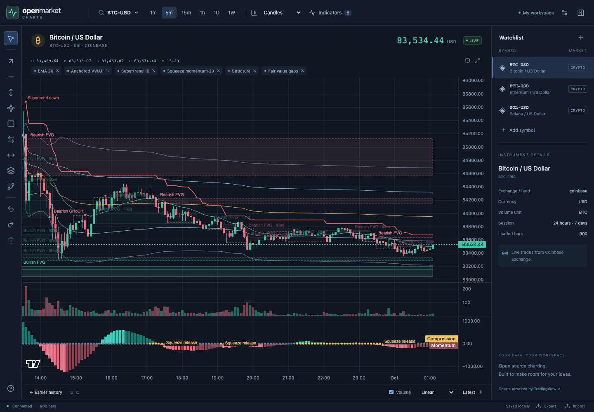
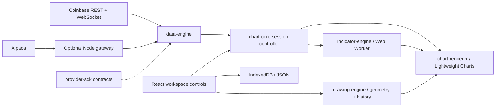

# Open Market Charts

An open-source chart workspace with live market data, independent indicator and drawing engines, and replaceable data providers. Built with TradingView Lightweight Charts and TypeScript.

**v0.1 is an early release:** a working foundation for a charting product, with documented tests and measurements. APIs may change. See [verification](docs/verification.md) for what has been checked and the [roadmap](docs/roadmap.md) for planned work.



## Start locally

Install **Node.js 24 or newer**, then run:

```sh
git clone https://github.com/RoryNaught/open-market-charts.git
cd open-market-charts
npm ci
npm run dev
```

Open **http://127.0.0.1:5173**. Bitcoin history and live trades load from Coinbase Exchange without an API key or backend. Provider failures appear in the interface; the app never substitutes simulated prices for a failed feed.

Try the symbol search, change a timeframe, add a study from **Indicators**, or select a drawing tool on the left. Your workspace saves in this browser automatically. Use **Export** before moving to a different browser or domain.

For offline development, open **http://127.0.0.1:5173/?dev=1** to explicitly select the deterministic simulator. The interface labels it **SIMULATED**. Open the URL without the query to return to real feeds.

For stocks and ETFs, including SPY, follow the [optional Alpaca gateway setup](docs/deployment.md). Credentials stay in the gateway process. This adapter uses the IEX feed; live account connectivity and entitlements must be checked with your own account. IBKR support is planned.

## Included in v0.1

| Area             | Features                                                                                                                                                                             |
| ---------------- | ------------------------------------------------------------------------------------------------------------------------------------------------------------------------------------ |
| Charts           | Candles, OHLC bars, line, area and Heikin-Ashi; volume; synchronized time axis and crosshair; resizable indicator panes                                                              |
| Navigation       | Mouse/touch pan and zoom; symbol search and watchlist; six timeframes; backward pagination; autoscale; linear, logarithmic and percentage scales; optional second price scale        |
| Sessions         | Provider calendars for stock aggregation, regular/extended filtering, session boundaries and extended-hours shading; exchange-time labels over UTC data                              |
| Indicators       | SMA, EMA, VWAP, RSI, MACD, Bollinger Bands, ATR and visible-range Volume Profile                                                                                                     |
| Advanced studies | Anchored VWAP with deviation bands, Supertrend, squeeze momentum, confirmed market structure and swing sweeps, fair-value-gap zones                                                  |
| Drawings         | Trend, horizontal and vertical lines; rays; rectangles; price/date ranges; Fibonacci retracements; parallel channels; selection, dragging, resizing, styling, deletion and undo/redo |
| Workspace        | Versioned IndexedDB snapshots with a prior-valid backup; JSON import/export; symbol-scoped drawings and pane sizing                                                                  |
| Providers        | Public Coinbase Exchange, optional read-only Alpaca gateway, and an explicit development simulator                                                                                   |

Studies support configurable parameters and removal. Numeric studies can use the price chart or their own pane; structure and gap annotations stay on the price chart. Colors are configurable where the study does not encode direction or state with fixed colors.

Anchored VWAP starts at the first visible candle when added; **Pick candle** sets a fixed UTC anchor. Structure labels appear on the confirming candle, with references to the source swing. Gap zones progress from active to touched to filled. Supertrend lines and momentum values update while a candle forms; their event labels wait for confirmation. Exact conventions are in the [indicator guide](docs/indicators.md), [trend formulas](docs/advanced-trends.md) and [price-action rules](docs/price-action.md).

## Current limits

- Volume Profile estimates volume at price from OHLCV. Order-flow delta and depth heatmaps need additional trade-side and order-book data and are not implemented.
- Coinbase represents one exchange. Alpaca IEX has narrower coverage than consolidated US data. Stock history is unadjusted; stock candles update on the provider's minute cadence while trade and quote events stream separately.
- Indicators use original bars, even when displaying Heikin-Ashi. Historical corrections or expanded history can recalculate earlier results; closed-candle confirmation does not make history immutable.
- The browser saves one current workspace and a recovery backup. Named presets, alerts, durable market-history storage, cloud sync and order execution are not included. Gateway connections must be re-established after a reload.
- Benchmarks measure specific workloads on named hardware. Dense full-history zoom, 500,000 bars with all studies in the browser, and prolonged sessions still need measurements. See [performance](docs/performance.md).
- Plugins are reviewed modules compiled into the application and worker. There is no runtime plugin marketplace or sandbox for downloaded code.

The calculations are original implementations of documented methods. They do not reproduce private vendor scripts or promise identical signals to proprietary products.

## Architecture



| Module                      | Responsibility                                                                                           |
| --------------------------- | -------------------------------------------------------------------------------------------------------- |
| `packages/provider-sdk`     | Normalized bars, trades, quotes, calendars and provider contracts; UTC millisecond timestamps            |
| `packages/data-engine`      | Adapters, aggregation, revisions, recovery, batching and deterministic simulation                        |
| `packages/chart-core`       | Cancelable market sessions, history/live reconciliation, coordinate transforms and workspace persistence |
| `packages/indicator-engine` | Independent calculation kernels, plugin registry, incremental state and worker transport                 |
| `packages/drawing-engine`   | Independent anchors, geometry, hit testing, pointer gestures, serialization and undo history             |
| `packages/chart-renderer`   | Lightweight Charts integration through public APIs; viewport rendering and canvas overlays               |
| `apps/web`                  | React controls and application wiring; market ticks update imperative chart APIs                         |
| `apps/gateway`              | Optional read-only stock-data service; credentials, calendars, history and multiplexed streaming         |

Read the [architecture decisions](docs/architecture.md), [provider interfaces](docs/providers.md), [indicator plugin contract](docs/indicators.md) and [drawing architecture](docs/drawings.md) before extending an engine. Workspace packages currently ship as source in this repository, not separately published npm packages.

## Development and verification

```sh
npm run format:check
npm run typecheck
npm test
npm run build
npx playwright install chromium firefox webkit
npm run test:e2e
```

Browser tests cover Chromium, Firefox, WebKit and a touch viewport using deterministic feeds and mocked provider transports. Separate public Coinbase smoke checks are recorded in [verification](docs/verification.md). Live Alpaca validation requires credentials; fixture tests do not verify account-specific access.

For profiling, follow [the benchmark instructions](docs/performance.md). Record the runtime, hardware and workload, and keep numerical-engine timings separate from browser readiness, frame timing and memory. Run performance measurements without concurrent tests or source edits.

## Build and deploy

```sh
npm run build
npm run preview
```

Preview the build at **http://127.0.0.1:4173**. Deploy `dist/` to an HTTPS static host. The optional stock gateway runs separately; [deployment documentation](docs/deployment.md) covers local setup, a container and an authenticated reverse proxy.

Workspace data belongs to its browser origin. Export/import moves it between origins. Market history is fetched on demand; credentials and gateway tokens are excluded from saved workspaces. There are no hosted accounts or trading endpoints.

## Contributing and license

See [CONTRIBUTING.md](CONTRIBUTING.md) and the [prioritized roadmap](docs/roadmap.md). Bugs with reproducible fixtures and small improvements to an existing workflow are good starting points.

Apache-2.0; see [LICENSE](LICENSE) and [NOTICE](NOTICE). Open Market Charts uses [TradingView Lightweight Charts](https://github.com/tradingview/lightweight-charts), React and other open-source dependencies. Retain the chart attribution link and bundled third-party notices. TradingView Advanced Charts, embedded TradingView widgets and paid chart components are not used.
